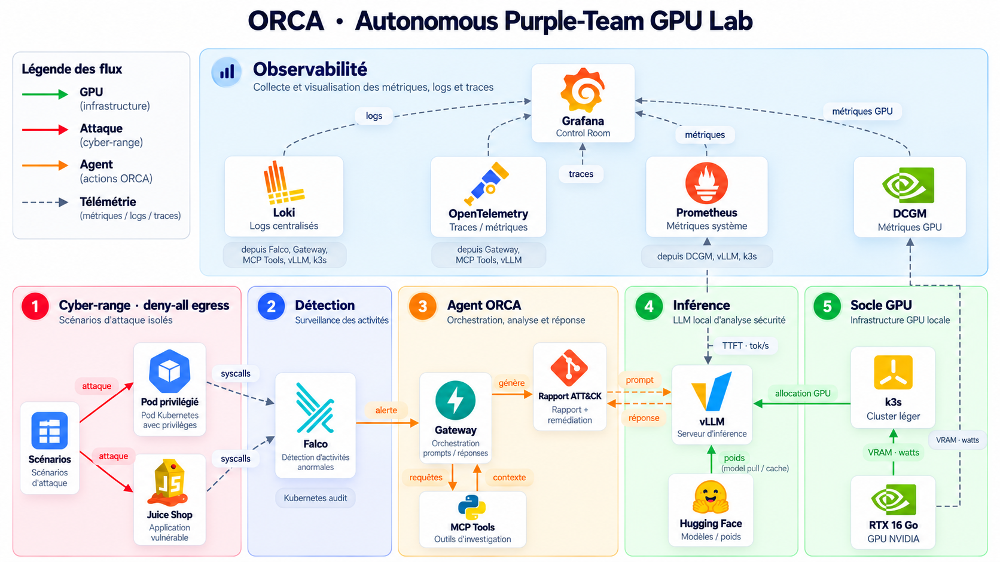
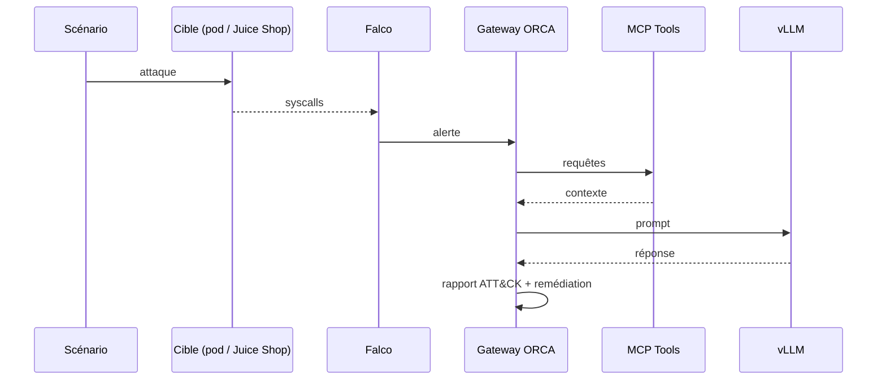

# Phantom Range

**ORCA, un lab purple team autonome qui tourne sur un seul GPU.**

On lance une attaque dans un cyber-range isolé, Falco la voit passer, et un agent branché sur un LLM local enquête puis rédige le rapport ATT&CK. Le tout sans appeler d'API externe.

## L'idée

Monter un SOC pour s'entraîner coûte cher et finit souvent par dépendre d'un LLM hébergé chez quelqu'un d'autre. Ici tout tient sur une machine avec une carte NVIDIA de 16 Go. Le red team attaque, le blue team détecte, et l'agent ORCA fait le boulot d'un analyste de niveau 1 : il récupère le contexte, interroge le modèle et sort un rapport avec la remédiation.

Le range est fermé en sortie (deny-all egress). Les scénarios d'attaque ne peuvent rien toucher en dehors du cluster.

## Comment ça s'enchaîne

## Les cinq blocs

| # | Bloc | Composants | Rôle |
|---|------|------------|------|
| 1 | Cyber-range | Scénarios, pod privilégié, OWASP Juice Shop | Cibles vulnérables, egress bloqué |
| 2 | Détection | Falco, audit Kubernetes | Repère les syscalls et appels API anormaux |
| 3 | Agent ORCA | Gateway, MCP Tools | Reçoit l'alerte, enquête, rédige le rapport |
| 4 | Inférence | vLLM, modèles Hugging Face | LLM local d'analyse sécurité |
| 5 | Socle GPU | k3s, RTX 16 Go | Cluster léger et allocation GPU |

Par-dessus, il y a une couche d'observabilité. Loki centralise les logs (Falco, Gateway, MCP Tools, vLLM, k3s), OpenTelemetry les traces, Prometheus les métriques système et DCGM la VRAM et la conso du GPU. Tout remonte dans Grafana, qui sert de salle de contrôle. On y suit aussi le TTFT et le débit en tokens/s de vLLM, pour voir si le modèle tient quand plusieurs alertes tombent en même temps.

Dans le schéma, le vert c'est l'infra GPU, le rouge l'attaque, l'orange les actions de l'agent et le pointillé la télémétrie.

## Prérequis visés

- une carte NVIDIA avec 16 Go de VRAM
- un hôte Linux avec les drivers NVIDIA et le device plugin (ou le GPU Operator)
- k3s
- un accès à Hugging Face pour tirer les poids du modèle la première fois

## Avancement

- [ ] Socle k3s avec le GPU exposé au cluster
- [ ] vLLM qui sert un modèle sur la carte
- [ ] Cyber-range isolé (NetworkPolicy deny-all egress)
- [ ] Falco et audit Kubernetes
- [ ] Gateway ORCA et outils MCP
- [ ] Génération du rapport ATT&CK
- [ ] Observabilité et dashboards Grafana

## Avertissement

Ce dépôt déploie exprès des applications vulnérables et des pods privilégiés. À lancer sur une machine de lab, jamais sur un réseau de prod ni exposé sur Internet.
